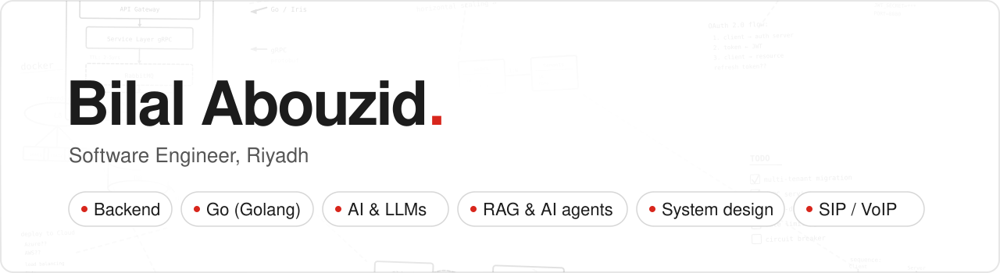
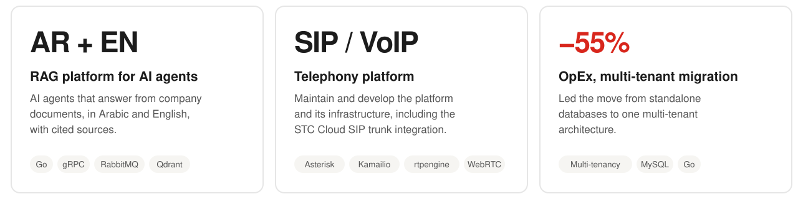

Software engineer with 3+ years building distributed, event-driven SaaS platforms in **Go**, from architecture to production. I designed and built an Arabic/English **RAG platform for AI agents**, maintain and develop a SIP/VoIP **telephony platform and its infrastructure**, and led a multi-tenant migration that **cut OpEx by 55%**.

**Backend** &nbsp; Go · Python · TypeScript · Microservices · Distributed systems · System design · gRPC · RabbitMQ 
**AI** &nbsp; LLMs · NLP · RAG · AI agents · Qdrant · Transformers · BERT 
**Cloud & data** &nbsp; Kubernetes · Docker · AWS · MySQL · Redis · Prometheus 
**Telephony** &nbsp; SIP · VoIP · Asterisk · Kamailio · rtpengine · WebRTC

**Research** &nbsp; [Beyond 512 Tokens: Utilizing the BERT Language Model in Question Answering for Long Input Processing](https://library.ciu.edu.tr/cgi-bin/koha/opac-detail.pl?biblionumber=292999) (MSc thesis, 2024)

[Website](https://bilalabouzid.com) &nbsp;·&nbsp; [CV](https://bilalabouzid.com/Bilal-Abouzid-CV-2026.pdf) &nbsp;·&nbsp; [LinkedIn](https://linkedin.com/in/bilal-abouzid) &nbsp;·&nbsp; imBilalAbouzid@gmail.com
